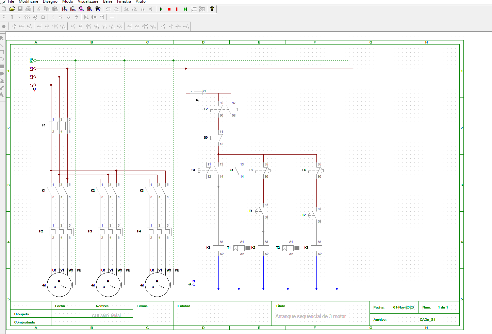
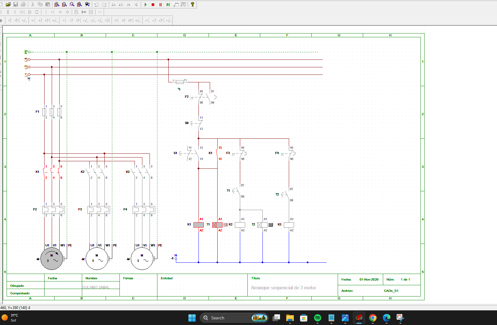
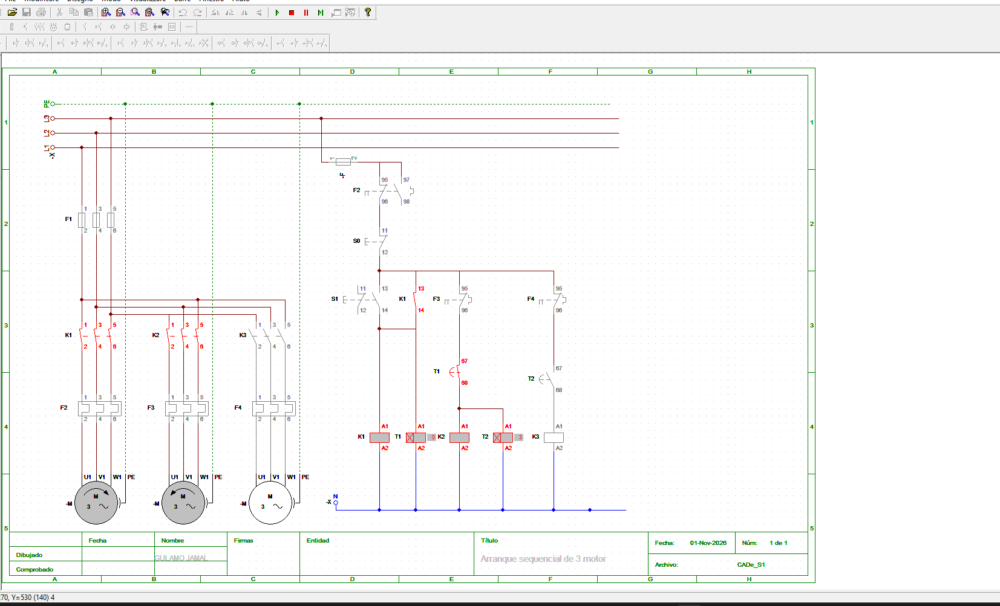
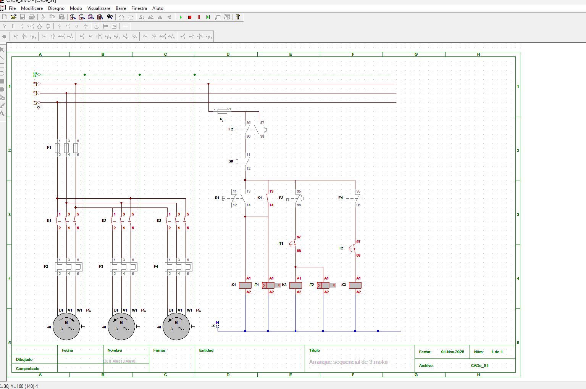

# Arranque Sequencial Automático de 3 Motores

## Descrição

Comando eléctrico para arranque sequencial automático de três motores trifásicos (M1, M2 e M3).

Um único botão arranca M1. Após 10 segundos, o temporizador T1 liga M2 e, após mais 10 segundos, o temporizador T2 liga M3.

> Diferença para o projecto [Arranque Sequencial](../arranque-sequencial): lá cada motor é accionado por uma botoeira (manual); aqui o arranque é automático e usa dois temporizadores.

---

## Funcionamento

1. Pressionar START (S1)
2. O contactor K1 energiza e fica retido pelo seu contacto auxiliar
3. M1 arranca e o temporizador T1 inicia a contagem
4. Após 10 segundos, K2 energiza e M2 arranca
5. O temporizador T2 inicia a contagem
6. Após mais 10 segundos, K3 energiza e M3 arranca
7. Pressionar STOP (S0) desliga todo o sistema

---

## Componentes

| Componente | Função |
|---|---|
| M1, M2, M3 | Motores trifásicos |
| F1 | Fusíveis do circuito de força |
| F | Fusível do circuito de comando |
| K1, K2, K3 | Contactores |
| F2, F3, F4 | Relés térmicos de M1, M2 e M3 |
| T1, T2 | Temporizadores com atraso à ligação (10 s) |
| S0 | Botoeira STOP (NF) |
| S1 | Botoeira START (NA) |

---

## Vídeo da simulação

Ver o vídeo: [Arranque sequencial de 3 motores (MP4)](https://brevemito.com/wp-content/uploads/2026/11/Arranque-sequencial-de-3-motores.mp4)

O vídeo mostra o esquema a funcionar: M1 accionado pela botoeira, M2 após 10 segundos e M3 após mais 10 segundos, incluindo a simulação de uma sobrecarga.

---

## Estados do esquema

### Motores desligados

### Motor 1 ligado

### Motores 1 e 2 ligados

### Três motores ligados

---

## Simulação de Sobrecarga

Quando a corrente de um motor ultrapassa o valor nominal, o relé térmico actua e abre o seu contacto no circuito de comando, protegendo o motor.

O contacto de F2 está em série com todo o circuito de comando, pelo que uma sobrecarga em M1 desliga todo o sistema.

---

## Aplicações

- Linhas de transporte e tapetes rolantes em cascata
- Sistemas de ventilação e exaustão
- Bombas e equipamentos que não devem arrancar em simultâneo
- Redução do pico de corrente na rede durante o arranque

Simulação realizada em CADe SIMU.

---

## Autor: Gulamo Jamal | غلام جمال | gulamo.jamal@outlook.com

